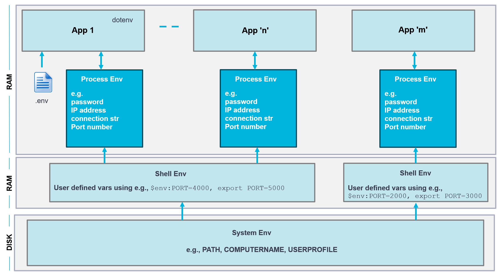

# Environment Variables

This demo implements various uses of environment variables to explain the discussion in the diagram

The demo illustrates reading env vars using **process.env** to read env vars into the application and and how to use the npm **dotenv** package to set environment variables from within the application at startup

